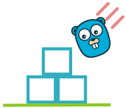

# Box2D Go

<p align="center"></p>

Go port of the [Box2D](https://github.com/erincatto/box2d) physics engine.

[](https://github.com/zigai/box2d-go/actions/workflows/ci.yml)
[](https://github.com/zigai/box2d-go/actions/workflows/oracle.yml)
[](https://pkg.go.dev/github.com/zigai/box2d-go/box2d)
[](https://github.com/zigai/box2d-go/blob/master/go.mod)
[](https://github.com/zigai/box2d-go/blob/master/LICENSE)

## Installation

```sh
go get github.com/zigai/box2d-go/box2d
```

Requires Go 1.27 or newer.

## Examples

### Drop a ball

```go
def := box2d.DefaultWorldDef()
world := box2d.NewWorld(&def)
defer world.Close()

bodyDef := box2d.DefaultBodyDef()
bodyDef.Type = box2d.DynamicBody
bodyDef.Position = box2d.Pos{Y: 10}
body := world.CreateBody(&bodyDef)

shapeDef := box2d.DefaultShapeDef()
body.CreateCircleShape(&shapeDef, &box2d.Circle{Radius: 0.5})

for range 60 {
	world.Step(1.0/60, 4)
}
```

The interactive app in [`samples/`](samples) shows many more scenes.

## Build options

- `-tags box2d_double`: double-precision positions for large worlds.
- `GOEXPERIMENT=simd`: experimental AVX backend on amd64. See [SIMD notes](docs/simd.md).

## License

[MIT](LICENSE)
